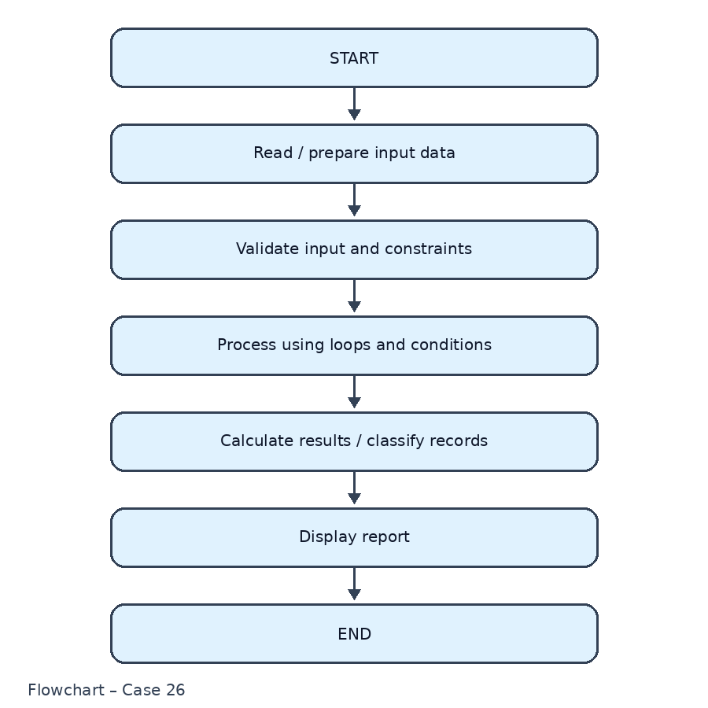
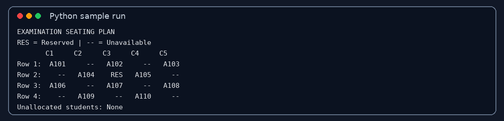

# Case Study 26: Nested Loop Examination Seating Generator

## 1. Problem Statement
Generate a classroom seating arrangement with row and column identifiers, reserved positions, alternate seating restrictions, and fixed classroom capacity.

## 2. Objectives
- Represent classroom seats as a nested list.
- Use nested loops to assign students to allowed positions.
- Preserve reserved seats and identify unallocated students.

## 3. Assumptions
- The classroom has 4 rows and 5 columns.
- Seat (2, 3) is reserved; row and column numbering starts at 1.
- Alternate seating is used: only positions where row + column is even are available.
- Students are allocated in the order provided.

## 4. Algorithm
1. Create an empty nested list for the classroom.
2. Loop through each row and each column.
3. Mark reserved positions first.
4. For remaining positions, allocate the next student only when the alternate-seat condition is met.
5. Mark all other positions as unavailable.
6. Display the seating chart and any unallocated students.

## 5. Flowchart
The diagram below shows the overall program flow. Detailed case-specific decisions are implemented in `solution.py`.



## 6. Pseudocode
```text
START
SET rows = 4, columns = 5
CREATE empty classroom matrix
SET student_index = 0
FOR row from 1 to rows
  FOR column from 1 to columns
    IF position is reserved, STORE RESERVED
    ELSE IF row + column is even AND a student remains
      ASSIGN next student and advance index
    ELSE STORE --
  END FOR
END FOR
DISPLAY classroom row by row
DISPLAY unallocated students
STOP
```

## 7. Python Source Code
See [`solution.py`](solution.py). The program uses Python built-in features and no third-party packages.

## 8. Test Cases

| Test | Input / condition | Expected result |
|---|---|---|
| Normal allocation | 10 student IDs, 4×5 classroom | Only alternating positions receive IDs; reserved seat remains RES |
| Reserved seat | Reserve (2, 3) | Cell in row 2, column 3 is RES |
| More students than seats | Provide 15 IDs | Students who do not fit are listed as unallocated |
| No students | Provide empty list | All eligible positions remain -- |

## Sample Output
The included program was run with the sample data in `main()`. The captured output is also saved as `sample_output.txt`.



## 9. Output Screenshot
This terminal-style screenshot is a generated capture of the sample program output. Run `python solution.py` to reproduce it.

## 10. Conclusion
The program creates a seating matrix with nested loops and conditions, while preserving reserved seats and reporting students who could not be allocated.
